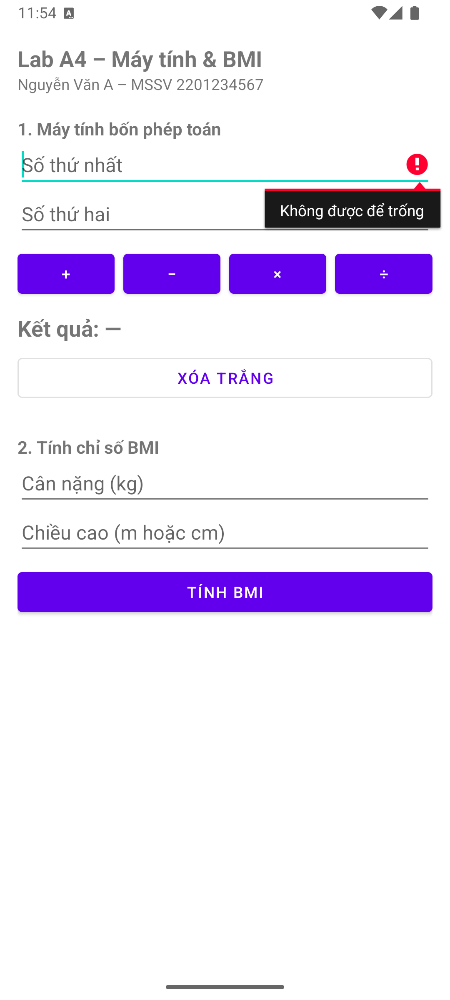
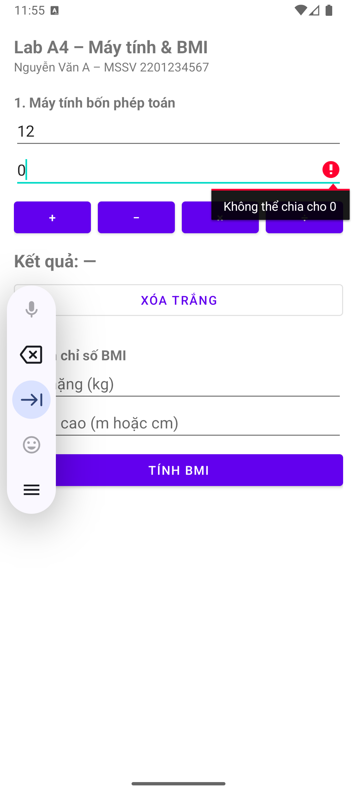
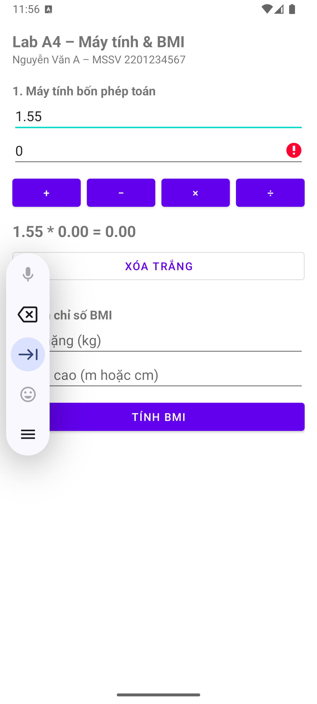

# BÁO CÁO LAB A4 - LẬP TRÌNH DI ĐỘNG

**Họ và tên:** Võ Văn Quốc Bảo
**MSSV:** 231A290036

## 1. Ghi chú tiêu chuẩn áp dụng (Bài BMI)
Ứng dụng sử dụng ngưỡng đánh giá phân loại BMI theo khuyến nghị của WHO dành cho khu vực Châu Á (bình thường từ 18.5 đến 22.9).

## 2. Bảng 10 Test Case kiểm thử ứng dụng

| # | Dữ liệu nhập | Kết quả mong đợi | Kết quả thực tế (Đạt/Không đạt) |
| :--- | :--- | :--- | :--- |
| 1 | A = 12, B = 3, bấm ÷ | Hiện 4.00 — không crash | Đạt |
| 2 | A = 12, B = 0, bấm ÷ | Báo lỗi "Không thể chia cho 0" tại ô B | Đạt |
| 3 | A để trống, bấm + | Báo lỗi tại ô A, con trỏ nhảy về ô A | Đạt |
| 4 | A = "abc" (dán chữ vào), bấm × | Toast báo sai định dạng, không crash | Đạt |
| 5 | A = -5.5, B = 2, bấm − | Hiện -7.50 | Đạt |
| 6 | A = 1.5.5 (hai dấu chấm), bấm + | Toast báo sai định dạng | Đạt |
| 7 | Cân nặng 60, chiều cao 1.70 | BMI = 20.8 — Bình thường | Đạt |
| 8 | Cân nặng 60, chiều cao 170 | Vẫn ra BMI = 20.8 (tự quy đổi cm) | Đạt |
| 9 | Chiều cao = 0 | Báo lỗi, không hiện Infinity hay crash | Đạt |
| 10 | A = khoảng trắng, bấm + | Báo lỗi "Không được để trống" ở ô A | Đạt |

## 3. Hình ảnh 3 trường hợp lỗi (Screenshot)
*(Đã chụp từ máy ảo)*
*   **Ảnh 1:** Chụp màn hình báo lỗi khi để trống ô nhập.
    
*   **Ảnh 2:** Chụp màn hình lỗi khi chia cho 0.
    
*   **Ảnh 3:** Chụp màn hình thông báo Toast khi nhập chữ vào ô số.
    

## 4. Trả lời câu hỏi ôn tập

**Câu 1: Ba bước xử lý một sự kiện là gì? Vì sao findViewById phải đặt sau setContentView?**
*   **Ba bước xử lý sự kiện:** (1) Ánh xạ view (tìm đối tượng từ giao diện); (2) Gán bộ lắng nghe sự kiện (setOnClickListener); (3) Xử lý logic khi sự kiện xảy ra (viết code trong hàm).
*   **Lý do:** `setContentView` có nhiệm vụ nạp file giao diện (XML) vào bộ nhớ để hiển thị. Nếu gọi `findViewById` trước, các view chưa tồn tại, hàm sẽ trả về `null` và gây lỗi sập ứng dụng (`NullPointerException`) ngay khi người dùng tương tác.

**Câu 2: Vì sao inputType không thay thế được việc kiểm tra dữ liệu trong code?**
*   Vì thuộc tính `inputType` trên giao diện chỉ giới hạn bàn phím ảo bật lên. Người dùng hoàn toàn có thể dùng bàn phím cứng, hoặc sao chép (copy) và dán (paste) dữ liệu chữ vào ô, hoặc nhập sai định dạng số (như `1.5.5`). Do đó, phải kiểm tra dữ liệu trong mã nguồn để đảm bảo an toàn tuyệt đối.

**Câu 3: Bốn lớp kiểm tra dữ liệu theo thứ tự nào? Cho ví dụ mỗi lớp trong bài của bạn.**
Bốn lớp kiểm tra dữ liệu theo thứ tự là:
1.  **Lớp rỗng:** Kiểm tra xem người dùng có nhập gì chưa. *VD: `if (chuoiA.isEmpty())`.*
2.  **Lớp định dạng:** Kiểm tra xem dữ liệu có đúng là số hay không. *VD: Đưa hàm `Double.parseDouble(chuoiA)` vào khối lệnh `try-catch`.*
3.  **Lớp miền giá trị:** Kiểm tra số liệu có hợp lý theo quy tắc toán học. *VD: Mẫu số phải khác 0 `if (phepToan == '/' && b == 0)` hoặc Chiều cao, cân nặng lớn hơn 0.*
4.  **Lớp nghiệp vụ:** Quy tắc riêng của bài toán. *VD: Áp dụng chuẩn BMI Châu Á để phân loại thay vì chuẩn Châu Âu.*

**Câu 4: Khi nào dùng setError, khi nào dùng Toast?**
*   **`setError`:** Dùng khi lỗi thuộc về một ô nhập liệu cụ thể (VD: người dùng quên nhập một ô, lỗi chia cho 0 ở ô B). Điều này giúp chỉ rõ cho người dùng biết họ cần sửa ở đâu.
*   **`Toast`:** Dùng cho các thông báo chung chung, hoặc các lỗi không thuộc cụ thể một vị trí view nào (VD: "Vui lòng nhập đúng định dạng số" khi bị văng `NumberFormatException`).

**Câu 5: Vì sao phải truyền Locale cho String.format?**
*   Do thiết lập khu vực (Region) và ngôn ngữ trên mỗi điện thoại khác nhau. Ở một số ngôn ngữ (như tiếng Việt), số thập phân dùng dấu phẩy (`,`), trong khi ngôn ngữ tiếng Anh dùng dấu chấm (`.`). Việc truyền cụ thể `Locale` (như `Locale.getDefault()`) vào `String.format` giúp kết quả hiển thị nhất quán, tránh lỗi định dạng và cảnh báo của IDE.